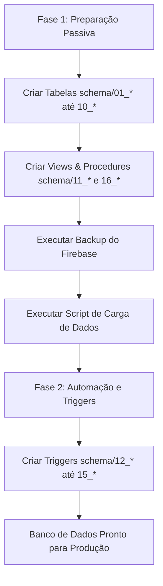

# Estratégia de Migração Firebase para PostgreSQL em Fases

Este documento descreve o processo de migração e consolidação do banco de dados relacional PostgreSQL do projeto **Saber Espírita**, garantindo 100% de integridade e fidelidade dos dados históricos durante a importação.

---

## 🗺️ Por que em Fases?

No Firebase Firestore, as estatísticas, rankings e dados consolidados são calculados e mantidos em tempo real por Cloud Functions e triggers. 
No PostgreSQL, implementamos essa mesma lógica utilizando **Triggers de Banco de Dados** nativos para evitar custos de computação e leitura na nuvem.

Se criarmos os triggers **antes** de importar os dados históricos:
1. Cada linha de log importada disparará contadores incrementais, gerando **dados corrompidos por dupla contagem**.
2. A velocidade da migração será drasticamente reduzida devido ao processamento repetitivo dos triggers para dados antigos.
3. Notificações antigas seriam disparadas novamente.

Portanto, dividimos a migração em duas fases claras:



---

## 🛠️ Fase 1: Estruturas Passivas, Backup e Importação de Dados

### 1. Criar a estrutura e as Views/Procedures
Conectado ao seu banco `saber_espirita_db` no PostgreSQL, execute os esquemas na ordem numérica:

```bash
# 1. Esquemas das Tabelas Base
psql -U postgres -d saber_espirita_db -f schema/01_enums.sql
psql -U postgres -d saber_espirita_db -f schema/02_users.sql
psql -U postgres -d saber_espirita_db -f schema/03_courses.sql
psql -U postgres -d saber_espirita_db -f schema/04_exercises.sql
psql -U postgres -d saber_espirita_db -f schema/05_quizzes.sql
psql -U postgres -d saber_espirita_db -f schema/06_content.sql
psql -U postgres -d saber_espirita_db -f schema/07_forum.sql
psql -U postgres -d saber_espirita_db -f schema/08_user_activity.sql
psql -U postgres -d saber_espirita_db -f schema/09_stats_logs.sql
psql -U postgres -d saber_espirita_db -f schema/10_views_indexes.sql

# 2. Views de Analytics e Stored Procedures de Limpeza (Fase 1 - Passivas)
psql -U postgres -d saber_espirita_db -f schema/11_analytics_views.sql
psql -U postgres -d saber_espirita_db -f schema/16_maintenance_procedures.sql
```

### 2. Gerar o Backup do Firebase
Acesse a pasta de scripts, configure o `.env` e a chave `serviceAccountKey.json`, e execute o backup:
```bash
cd Postgresql/scripts
npm install
npx ts-node export_firebase_backup.ts
```
Os dados serão salvos em uma subpasta em `Postgresql/scripts/backups/`.

### 3. Rodar a Migração dos Dados
Com o diretório de backup gerado, faça a carga dos dados históricos:
```bash
npx ts-node migrate_json_to_postgres.ts ./backups/backup_YYYY-MM-DD_HH-mm-ss
```
*(Substitua pela pasta do backup mais recente).*

---

## ⚡ Fase 2: Ativação dos Triggers (Pós-Importação)

Após a importação ter sido concluída com sucesso e os registros históricos estarem estáveis no PostgreSQL, execute os scripts de triggers para habilitar a automação em tempo real das novas ações do app:

```bash
# 1. Segurança e Moderação
psql -U postgres -d saber_espirita_db -f schema/12_security_mod_triggers.sql

# 2. Contadores e Cálculo de Nível Comunitário
psql -U postgres -d saber_espirita_db -f schema/13_stats_counters_triggers.sql

# 3. Fórum e Notificações de Linha de Discussão/Reações
psql -U postgres -d saber_espirita_db -f schema/14_forum_triggers.sql

# 4. Processamento Unificado de Logs de Engajamento
psql -U postgres -d saber_espirita_db -f schema/15_app_logs_trigger.sql
```

---

## 📈 Relação dos Novos Arquivos Criados

| Arquivo DDL | Tipo | Função na Arquitetura |
| :--- | :--- | :--- |
| **[`11_analytics_views.sql`](file:///c:/SaberEpirita/SaberEspirita-Util/Postgresql/schema/11_analytics_views.sql)** | Views | Agregações de progresso e engajamento global em tempo real para os painéis de administração. |
| **[`16_maintenance_procedures.sql`](file:///c:/SaberEpirita/SaberEspirita-Util/Postgresql/schema/16_maintenance_procedures.sql)** | Procedures | Procedures de zeragem periódica de pontuações de ranking e limpeza de logs obsoletos. |
| **[`12_security_mod_triggers.sql`](file:///c:/SaberEpirita/SaberEspirita-Util/Postgresql/schema/12_security_mod_triggers.sql)** | Triggers | Normaliza e-mail no insert e valida contra a blocklist de e-mails/domínios. |
| **[`13_stats_counters_triggers.sql`](file:///c:/SaberEpirita/SaberEspirita-Util/Postgresql/schema/13_stats_counters_triggers.sql)** | Triggers | Mantém totalizadores globais de alunos e recalcula nível comunitário na evolução de estudos. |
| **[`14_forum_triggers.sql`](file:///c:/SaberEpirita/SaberEspirita-Util/Postgresql/schema/14_forum_triggers.sql)** | Triggers | Insere notificações para participantes de fórum e gerencia reações e níveis. |
| **[`15_app_logs_trigger.sql`](file:///c:/SaberEpirita/SaberEspirita-Util/Postgresql/schema/15_app_logs_trigger.sql)** | Triggers | Escuta a tabela `app_logs` e atualiza `daily_stats`, `global_stats` e `item_stats` dinamicamente. |
